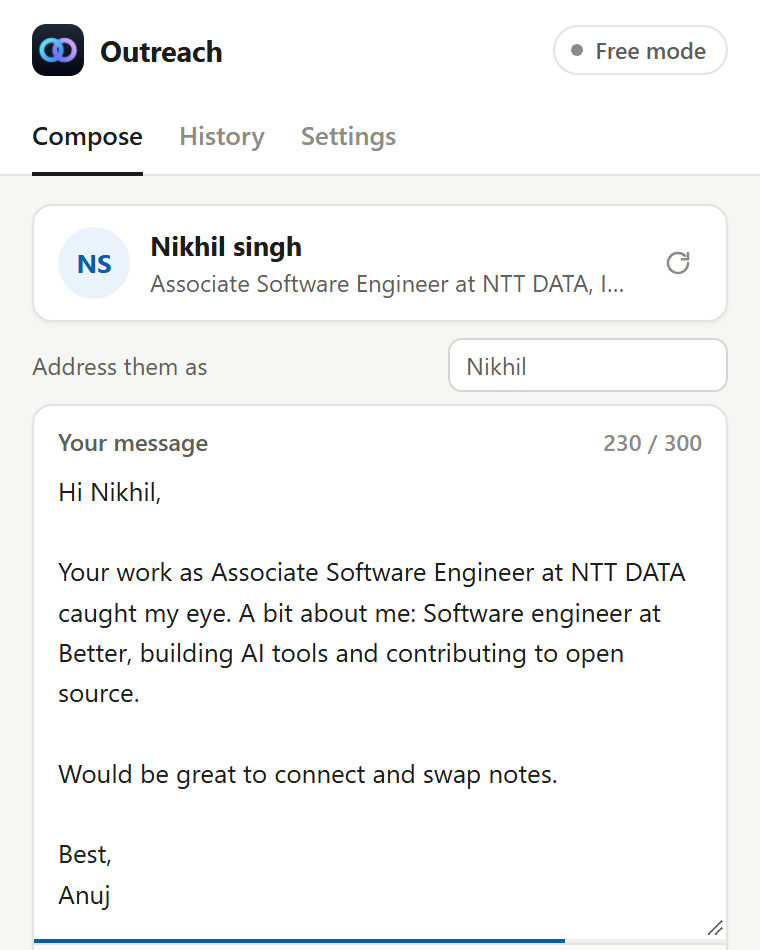
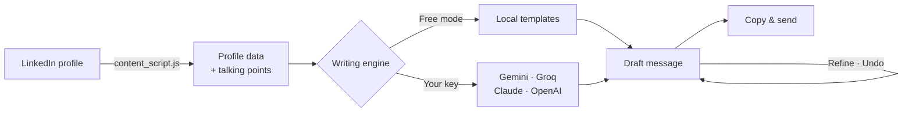

<div align="center">


# Outreach for LinkedIn

**Personal LinkedIn notes and messages, written from the profile in seconds.**

Read a profile, pick what to mention, write, refine, copy. Free out of the box, or bring your own AI.

<p>
  
  
  
  
  
</p>

<p>
  <a href="#-features">Features</a> ·
  <a href="#-quick-start">Quick start</a> ·
  <a href="#-bring-your-own-ai">AI providers</a> ·
  <a href="#-how-it-works">How it works</a> ·
  <a href="#-roadmap">Roadmap</a>
</p>

</div>

---

<table>
  <tr>
    <td align="center" width="33%"><br /><b>Compose</b><br /><sub>Reads the profile and writes the first draft</sub></td>
    <td align="center" width="33%"><br /><b>Refine</b><br /><sub>Edit with one tap or your own words</sub></td>
    <td align="center" width="33%"><br /><b>Choose your AI</b><br /><sub>Free templates or your own key</sub></td>
  </tr>
</table>

## 💡 Why

Cold outreach on LinkedIn works when it's short, specific and clearly written by a person. Writing that for every profile takes time, and generic templates get ignored.

**Outreach for LinkedIn** does the busy work. It reads the profile, suggests real talking points, and drafts a note you're happy to send. You stay in control of every word.

## ✨ Features

<table>
  <tr>
    <td width="50%" valign="top">
      <h4>🔍 Reads the profile for you</h4>
      Name, role, company, skills, education and recent posts, cleaned up and ready to use.
    </td>
    <td width="50%" valign="top">
      <h4>🎯 Real talking points</h4>
      Pick up to two true details to lead with. Nothing invented.
    </td>
  </tr>
  <tr>
    <td valign="top">
      <h4>🗣️ Purpose and tone</h4>
      Networking, Job, Referral or Collaboration; Formal, Neutral or Casual, with the matching greeting (Dear, Hi or Hey).
    </td>
    <td valign="top">
      <h4>📏 Fits LinkedIn's limits</h4>
      A Note/Message switch with a live <b>300-character</b> counter for connection requests.
    </td>
  </tr>
  <tr>
    <td valign="top">
      <h4>✏️ Refine, don't restart</h4>
      <i>Shorter · Fit 300 · More formal · Friendlier · Add a question</i>, or type your own instruction. Every change can be undone.
    </td>
    <td valign="top">
      <h4>🤖 Free or your own AI</h4>
      Works offline with templates, or with your own Gemini, Groq, Claude or OpenAI key. The model list loads live from the provider.
    </td>
  </tr>
  <tr>
    <td valign="top">
      <h4>📄 Knows your background</h4>
      Add a one-line bio and, optionally, your resume, so messages can mention one relevant credential.
    </td>
    <td valign="top">
      <h4>🕘 History</h4>
      Your last 20 messages, saved locally and ready to copy again.
    </td>
  </tr>
</table>

## 🚀 Quick start

No build step and no dependencies. Load it straight into Chrome:

```bash
git clone https://github.com/AnujShrivastava01/outreach-for-linkedin.git
```

1. Open **`chrome://extensions`** and turn on **Developer mode** (top right).
2. Click **Load unpacked** and select the `outreach-for-linkedin` folder.
3. Pin the extension, open any LinkedIn profile, and click **Read profile & write**.

That's it: Free mode works immediately.

## 🤖 Bring your own AI

For messages written from the full profile, open **Settings**, pick a provider, paste your key, choose a model and click **Test**.

| Provider | Default model | Get a key | Free tier |
|---|---|---|:---:|
| **Google Gemini** | `gemini-2.5-flash` | [aistudio.google.com](https://aistudio.google.com/app/apikey) | ✅ |
| **Groq** | `llama-3.3-70b-versatile` | [console.groq.com](https://console.groq.com/keys) | ✅ |
| **Anthropic Claude** | `claude-haiku-5-5` | [console.anthropic.com](https://console.anthropic.com/settings/keys) | — |
| **OpenAI** | `gpt-4o-mini` | [platform.openai.com](https://platform.openai.com/api-keys) | — |

> [!TIP]
> No key? Start with **Gemini** or **Groq**; both have free tiers. The model dropdown fills with every model your key can use.

## ⚙️ How it works



1. **Read:** `content_script.js` reads the profile from the page and cleans it up.
2. **Plan:** `background.js` turns it into talking points you can choose from.
3. **Write:** the message is written by local templates or by your chosen AI, using only real profile facts and a greeting that matches your tone.
4. **Refine:** quick edits or your own instruction rewrite the draft. Undo keeps the earlier versions.

## 🗂️ Project structure

```
outreach-for-linkedin/
├── manifest.json         # Extension config (Manifest V3)
├── content_script.js     # Reads the LinkedIn profile from the page
├── background.js         # Writes and refines messages (templates or AI providers)
├── popup.html            # Popup layout: Compose, History, Settings
├── popup.css             # Popup styles
├── popup.js              # Popup logic
├── utils/
│   └── cache.js          # Stores recent messages locally
├── icons/                # Extension icons
└── docs/screenshots/     # README images
```

## 🛠️ Tech stack

- **Vanilla JavaScript, HTML and CSS:** no frameworks, no bundler, nothing to install
- **Chrome Extensions Manifest V3:** service worker, content script and `chrome.storage`
- **AI APIs:** Google Gemini, Groq, Anthropic and OpenAI, called directly from the browser

## 🔒 Privacy

- Settings, API keys and history are stored only in your browser (`chrome.storage.local`).
- In AI mode, requests go **straight from your browser to the provider you choose**.
- There is no backend, analytics or tracking.

## 🧭 Roadmap

- [ ] One-click **Paste into LinkedIn** for the connection-note box
- [ ] Saved snippets about yourself (projects, wins) for the AI to pick from
- [ ] Follow-up message suggestions from History
- [ ] Publish to the Chrome Web Store

## 👤 Author

<div align="center">

**Anuj Shrivastava**

[](https://www.linkedin.com/in/anujshrivastava1)
[](https://github.com/AnujShrivastava01)
[](https://www.anujshrivastava.tech/)

If this helps you, consider giving the repo a ⭐

</div>
