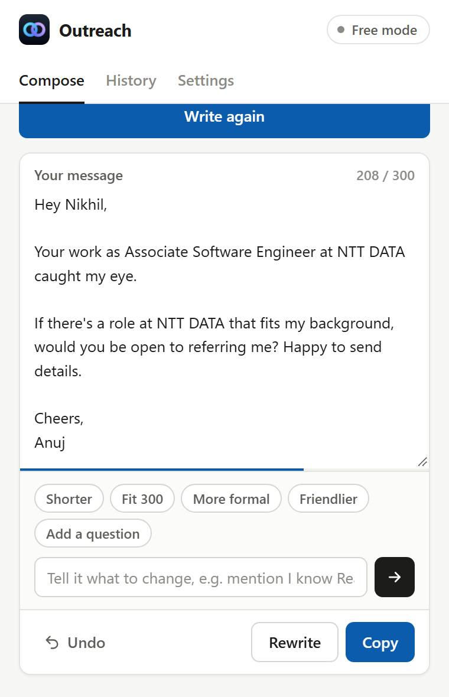
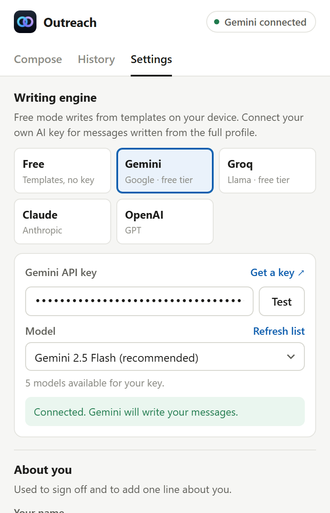

# Outreach for LinkedIn

A Chrome extension that reads a LinkedIn profile and writes a short, personal connection note or message, which you can refine and copy in one click.

It works for free out of the box, or with your own AI key from Gemini, Groq, Claude or OpenAI.

| Compose | Refine | Choose your AI |
|---|---|---|
|  |  |  |

## Features

- **Reads the profile for you:** name, role, company, skills, education and recent posts.
- **Talking points:** choose up to two real details from the profile to lead with.
- **Purpose and tone:** Networking, Job, Referral or Collaboration; Formal, Neutral or Casual, each with a matching greeting (Dear, Hi or Hey).
- **Note or Message:** a live 300-character counter for LinkedIn connection notes.
- **Refine, don't restart:** one-tap edits (Shorter, Fit 300, More formal, Friendlier, Add a question), your own instruction, and Undo.
- **Free mode or your own AI:** templates that run on your device, or your own key for Gemini, Groq, Claude or OpenAI. The model list loads live from the provider.
- **Uses your background:** add a one-line bio and, optionally, your resume, so messages can mention a relevant credential.
- **History:** your last 20 messages, ready to copy again.

## Install

1. Clone or download this repository.
2. Open `chrome://extensions` and turn on **Developer mode**.
3. Click **Load unpacked** and select the project folder.
4. Open any LinkedIn profile, click the extension icon, then click **Read profile & write**.

### Use your own AI (optional)

Open **Settings**, pick a provider, paste your API key, choose a model and click **Test**.

| Provider | Get a key | Free tier |
|---|---|---|
| Google Gemini | [aistudio.google.com](https://aistudio.google.com/app/apikey) | Yes |
| Groq | [console.groq.com](https://console.groq.com/keys) | Yes |
| Anthropic Claude | [console.anthropic.com](https://console.anthropic.com/settings/keys) | No |
| OpenAI | [platform.openai.com](https://platform.openai.com/api-keys) | No |

## Project structure

```
manifest.json        Extension config (Manifest V3)
content_script.js    Reads the LinkedIn profile from the page
background.js        Writes and refines messages (templates or the chosen AI provider)
popup.html/css/js    The popup: Compose, History and Settings
utils/cache.js       Stores recent messages locally
icons/               Extension icons
```

## Privacy

Your settings, keys and history are stored only in your browser (`chrome.storage.local`). In AI mode, requests go straight from your browser to the provider you choose. There is no other server.

## Author

**Anuj Shrivastava** · [LinkedIn](https://www.linkedin.com/in/anujshrivastava1) · [GitHub](https://github.com/AnujShrivastava01) · [Portfolio](https://www.anujshrivastava.tech/)
